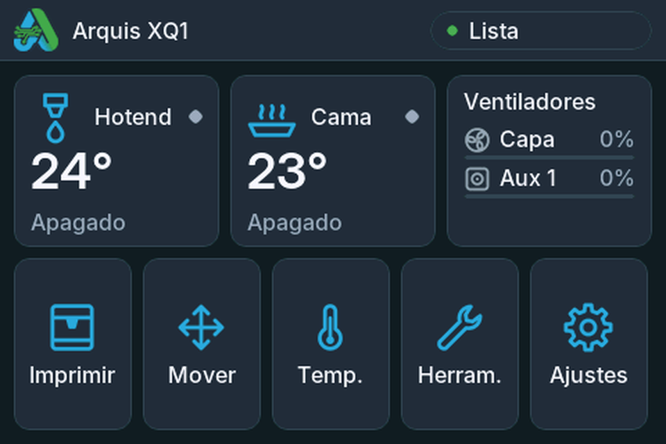
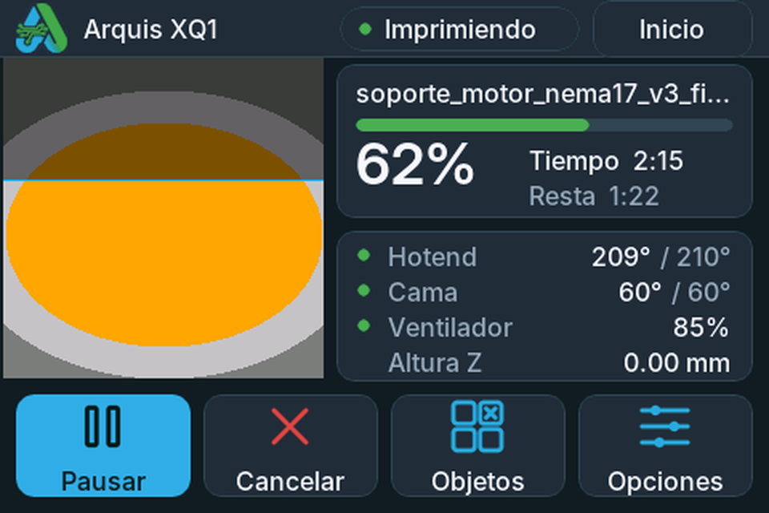
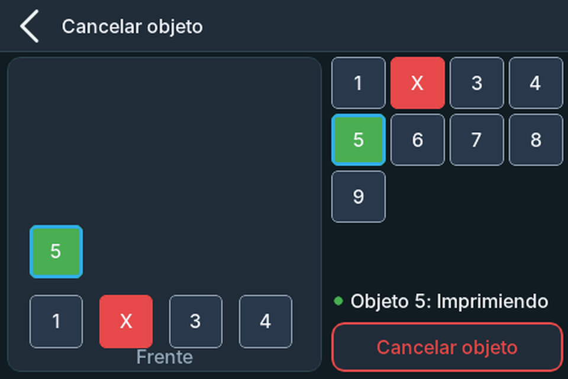
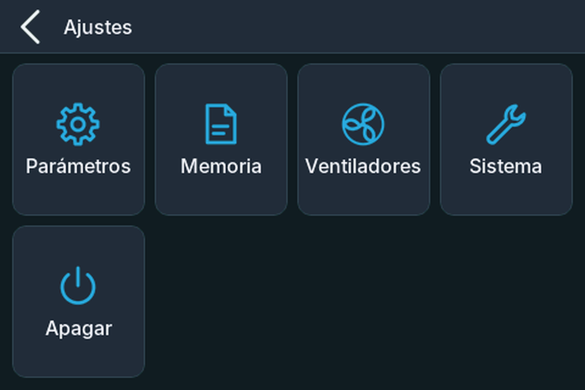
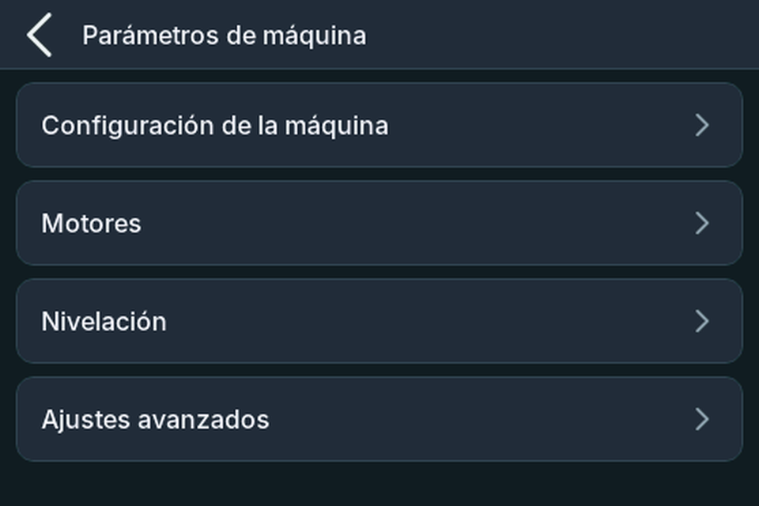
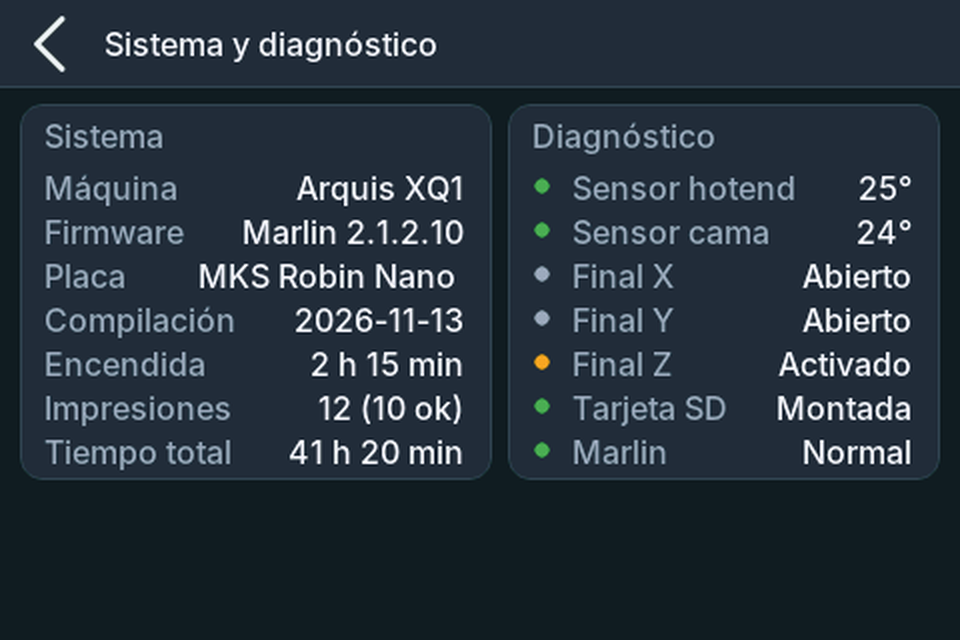

<p align="center">
  
</p>

<h1 align="center">Arquis Firmware XQ1</h1>

<p align="center">
  <b>ARQUIS UI 1.0.0</b> — interfaz táctil propia para la impresora 3D <b>Arquis XQ1</b><br>
  Marlin 2.1.2.10 · MKS Robin Nano V3.1 · pantalla MKS TS35 480×320
</p>

<p align="center">
  
  
  
  
</p>

<table>
  <tr>
    <td></td>
    <td></td>
    <td></td>
  </tr>
  <tr>
    <td align="center"><sub>Dashboard</sub></td>
    <td align="center"><sub>Imprimiendo</sub></td>
    <td align="center"><sub>Cancelar un objeto</sub></td>
  </tr>
  <tr>
    <td></td>
    <td></td>
    <td></td>
  </tr>
  <tr>
    <td align="center"><sub>Ajustes</sub></td>
    <td align="center"><sub>Parámetros</sub></td>
    <td align="center"><sub>Sistema y diagnóstico</sub></td>
  </tr>
</table>

## ¿Qué es?
Un firmware **Marlin 2.1.2.10** para la Arquis XQ1 con una interfaz propia que sustituye el aspecto de Makerbase **sin quitar ninguna función de Marlin**: paleta, tipografía (Inter), iconos y logo de ARQUIS, pensados para una pantalla pequeña y táctil. Las acciones que mueven la máquina, calientan o guardan datos son las llamadas originales de MKS/Marlin; solo cambia cómo se ven y se añaden confirmaciones donde una pulsación puede estropear una pieza.

## Características
- **Dashboard** con temperaturas, ventiladores y estado de la máquina (*Reposo, Lista, Calentando, Temp. alcanzada, Enfriando, Imprimiendo, Pausada, Error*).
- **Imprimir** con explorador de la SD y **miniatura del G-code** antes de empezar; **supervisión** con progreso, tiempos y control de pausa; **cancelar un objeto** sin parar el resto de la impresión.
- **Control** de temperatura, ventiladores, movimiento, extrusión, velocidad, *babystep*, *home*, nivelación de cama y **cambio de filamento**.
- **Ajustes**: ~15 pantallas de parámetros de máquina con teclado numérico propio, memoria (EEPROM), **sistema y diagnóstico en vivo** (sensores y finales de carrera), Wi-Fi, idioma (español / inglés) y consola de G-code.
- **Seguridad**: confirmación para cancelar, cambiar filamento en plena impresión, nivelación automática, apagar y restaurar valores de fábrica; durante una impresión *Mover* y *Ajustes* se bloquean.
- **Ligera**: ≈ 45 KB de Flash (11 %) y el peor caso usa ≈ 7 KB de los 16 KB del heap de LVGL.

Recorrido completo con capturas: [`docs/arquis/GUIA_USUARIO.md`](docs/arquis/GUIA_USUARIO.md).

## Base
| | |
|---|---|
| Firmware | Marlin **2.1.2.10** |
| Placa | MKS Robin Nano V3.1 (STM32F407VET6) · TMC2209 |
| Pantalla | MKS TS35 480×320 SPI · táctil XPT2046 · memoria W25Q SPI |
| Interfaz | `TFT_LVGL_UI` · LVGL **6.1.1-MKS** (sin actualizar la librería ni cambiar los controladores) |
| Entorno de PlatformIO | `mks_robin_nano_v3_1_usb_flash_drive_msc` |

## Inicio rápido
Requisitos: PlatformIO, Python 3 y una tarjeta SD en FAT32.
```bash
# 1) Compilar
pio run -e mks_robin_nano_v3_1_usb_flash_drive_msc

# 2) Armar el paquete para la SD (firmware + assets + instrucciones + sumas SHA-256)
python herramientas/arquis_ui/empaquetar_entrega.py RUTA/Robin_nano_v3.bin --salida entrega
```
3. Copia a la **raíz de la SD** el `Robin_nano_v3.bin` y la carpeta `assets` del paquete, con la impresora apagada y fría, y enciende.
4. Comprueba que *Ajustes → Sistema* dice **Interfaz ARQUIS 1.0.0** y recorre la [lista de verificación](docs/arquis/LISTA_VERIFICACION.md).

> ⚠️ Usa la carpeta [`sd_assets/`](sd_assets/) de este repositorio (renombrada a `assets`), **no** la que descarga PlatformIO: esa trae el logo y los iconos originales de Makerbase.
> Los pasos completos, la solución a problemas frecuentes (p. ej. `TMCStepper.h` en una unidad externa) y cómo volver atrás están en [`GUIA_INSTALACION.md`](docs/arquis/GUIA_INSTALACION.md).

## Lo que cambia respecto a Marlin
Fuera de la carpeta de la interfaz (`Marlin/src/lcd/extui/mks_ui/`), de la documentación y de las herramientas, **el único archivo de Marlin modificado es `Marlin/Configuration.h`**:
- `#define ARQUIS_UI` activa la interfaz (comentarlo devuelve la pantalla original de MKS);
- `ARQUIS_TFT_BYTE_SWAP` desactivado (con él activo los colores salían rotos).

**No se modificó** movimiento, planificador, temperatura ni protecciones térmicas, drivers TMC, finales de carrera ni ajustes de la máquina. Los archivos originales de MKS conservan su código dentro de bloques `#if ENABLED(ARQUIS_UI)` / `#else`. Compruébalo con:
```bash
git diff 0060ade HEAD --stat -- . ':!Marlin/src/lcd/extui/mks_ui' ':!docs' ':!herramientas' ':!sd_assets' ':!README.md' ':!CAMBIOS.md'   # 0060ade = main antes de ARQUIS UI
```

## Cifras (compilación real, Robin Nano V3.1)
| | |
|---|---|
| Flash | **≈ 85,6 %** (406 800 B de 475 136 B útiles; quedan ≈ 68 KB) |
| RAM | ≈ 61,6 % |
| Código de ARQUIS UI | ≈ 45 KB (11 % de la Flash) |
| Heap de LVGL, peor caso | ≈ 7 KB usados, ≥ 9,2 KB libres de 16 KB |
Desglose por módulo en [`ARQUIS_UI_etapa_6.md`](docs/arquis/ARQUIS_UI_etapa_6.md); medir de nuevo con `python herramientas/arquis_ui/auditar_flash.py RUTA/Robin_nano_v3.elf`.

## Documentación
| Quiero… | Documento |
|---|---|
| Ver qué incluye, las cifras y las limitaciones | [`ENTREGA_v1.0.0.md`](docs/arquis/ENTREGA_v1.0.0.md) |
| Compilar, empaquetar e instalar | [`GUIA_INSTALACION.md`](docs/arquis/GUIA_INSTALACION.md) |
| Usar la pantalla (con capturas) | [`GUIA_USUARIO.md`](docs/arquis/GUIA_USUARIO.md) |
| Aceptar una instalación nueva | [`LISTA_VERIFICACION.md`](docs/arquis/LISTA_VERIFICACION.md) |
| Historial de cambios por etapa | [`CAMBIOS.md`](CAMBIOS.md) y [`docs/arquis/`](docs/arquis/) (`ARQUIS_UI_etapa_*.md`) |
| El README original de Marlin | [`docs/README_MARLIN.md`](docs/README_MARLIN.md) |

## Estructura del repositorio
| Ruta | Qué es |
|---|---|
| `Marlin/src/lcd/extui/mks_ui/arquis_*` | Interfaz ARQUIS: vistas puras de LVGL (`*_view.cpp`) y pegamento con Marlin |
| `Marlin/src/lcd/extui/mks_ui/draw_*.cpp` | Pantallas originales de MKS, con bloques `ARQUIS_UI` |
| `sd_assets/` | Carpeta `assets` de la SD: logo de arranque, iconos y fuente |
| `herramientas/arquis_ui/` | Simulador y pruebas (`sim/`), generadores de iconos, logo y fuentes, `auditar_flash.py`, `empaquetar_entrega.py` |
| `docs/arquis/` | Guías, notas de versión, documentación por etapa y capturas |

## Probar la interfaz sin la impresora
El simulador dibuja las pantallas con **LVGL 6.1.1 real** (compilado para ARM de 32 bits, con el heap de 16 KB de la placa), simula toques y mide memoria y fugas:
```bash
herramientas/arquis_ui/sim/build_sim.sh          # genera las capturas y ejecuta 213 comprobaciones + 52 de lógica
herramientas/arquis_ui/sim/check_marlin_api.sh   # compila los archivos nuevos contra las firmas de Marlin
```
> El simulador y las firmas **no sustituyen** a la compilación completa con PlatformIO ni a la prueba en la impresora.

## Estado y limitaciones conocidas
Validada en la impresora **etapa a etapa** (Dashboard, impresión, control, ajustes y Wi-Fi).
- **Pendiente:** la cama marca ≈ 45 °C al encender con todo apagado. La interfaz muestra tal cual la lectura de Marlin; hay que comprobar el termistor (ver las notas de la versión). No se modificó la configuración térmica.
- La **perilla** (encoder) no opera las listas, teclados ni diálogos nuevos.
- Se conservan solo los idiomas **español e inglés** (con la interfaz de ARQUIS activa).
- Siguen con el aspecto original de MKS: calibración táctil, *Parámetros Wi-Fi* y *Nube MKS*.

## Créditos y licencias
- **[Marlin](https://marlinfw.org)** — GPL-3.0 (ver [`LICENSE`](LICENSE)); este repositorio es una variante de Marlin 2.1.2.10.
- **MKS / Makerbase**: soporte `TFT_LVGL_UI` y librería **LVGL 6.1.1-MKS** (LVGL: MIT), descargadas por PlatformIO. Las demás librerías descargadas conservan sus licencias.
- **Tipografía Inter** (Rasmus Andersson) — [SIL Open Font License 1.1](https://rsms.me/inter/); las fuentes de la interfaz se generan con `herramientas/arquis_ui/arquis_fuentes.sh`.
- **Iconos y logo de ARQUIS**: propios de Arquis Soluciones Tecnológicas.

Para el README original de Marlin (placas soportadas, comunidad, contribuir) consulta [`docs/README_MARLIN.md`](docs/README_MARLIN.md).
