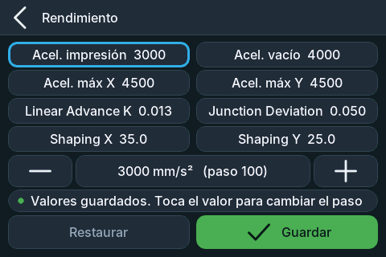
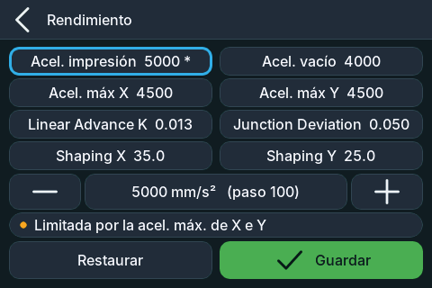
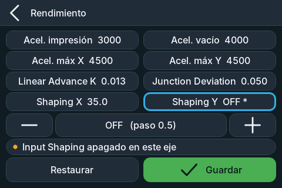
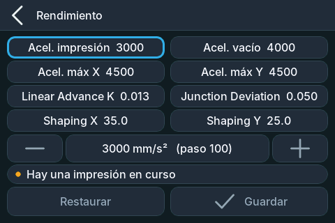

# ARQUIS — Rendimiento: ajustar velocidad y calidad desde la TS35 (sin recompilar)

Estado: **implementado y probado en PC (lógica, pantalla LVGL simulada, firmas contra Marlin, generador de G-code verificado). Sin compilar con PlatformIO completo ni probado en la impresora.**

Son dos piezas que se usan juntas:

1. **Pantalla Ajustes → Rendimiento** en la TS35: cambia al instante aceleraciones, Linear Advance, Junction Deviation e Input Shaping y los guarda en la EEPROM.
2. **Torres de prueba** (`herramientas/torres/`): archivos `.gcode` que **cambian un valor a medida que sube la pieza**. Se imprimen, se mira en qué tramo queda mejor y ese valor se escribe en la pantalla.

Así se mide con la propia impresora y no hace falta editar `Configuration.h`, compilar ni flashear en cada intento.

## 1. La pantalla «Rendimiento»



Cada tarjeta es un valor. Se toca la tarjeta, se cambia con **−** / **+** y el cambio **se aplica en el momento**:

| Tarjeta | Orden de Marlin | Para qué sirve | Rango de la pantalla / paso fino · grueso |
|---|---|---|---|
| Acel. impresión | `M204 P` | Rapidez al cambiar de dirección imprimiendo | 200–20000 · 100 · 500 mm/s² |
| Acel. vacío | `M204 T` | Idem, sin extruir | 200–20000 · 100 · 500 |
| Acel. máx X / Y | `M201 X` / `M201 Y` | **Techo** de las dos anteriores (Marlin recorta cualquier valor mayor) | 500–20000 · 250 · 1000 |
| Linear Advance K | `M900 K` | Presión del filamento en esquinas y costuras (OFF = apagado) | 0,005–2,000 · 0,005 · 0,05 mm |
| Junction Deviation | `M205 J` | Cuánto frena en las esquinas | 0,01–0,3 · 0,005 · 0,02 mm |
| Shaping X / Y | `M593 X F` / `M593 Y F` | Frecuencia de Input Shaping (OFF = apagado) | **desde 25 Hz** (mínimo compilado) hasta 200 · 0,5 · 5 Hz |

**Tocar el valor grande del centro** cambia entre paso **fino** y **grueso**.

* **Guardar** ejecuta `M500` y comprueba la EEPROM. Sin Guardar, los cambios viven en RAM y **se pierden al apagar** (la línea de estado lo avisa con «Cambios sin guardar»). Un asterisco `*` marca las tarjetas distintas de lo guardado.
* **Restaurar** vuelve a los valores guardados (o los del primer uso tras el arranque) y se activa solo si hay cambios.
* La línea de estado avisa, sin bloquear: «Limitada por la acel. máx. de X e Y» (si pides 5000 con un techo de 4500 Marlin aplicará 4500), «Mucho más alta que la guardada», «Input Shaping apagado en este eje», «Linear Advance apagado».
* Si tu firmware no tiene una función (p. ej. sin Linear Advance), su tarjeta sale deshabilitada.

### Por qué hay límites que parecen raros
* **Shaping no baja de 25 Hz.** Marlin dimensiona el búfer de Input Shaping al compilar con la frecuencia más baja configurada (aquí `min(35, 25) = 25 Hz`). Una frecuencia menor **desbordaría ese búfer**: la pantalla no la deja. Bajar del mínimo apaga el eje (OFF); subir desde OFF da 25 Hz. Para frecuencias menores habría que definir `SHAPING_MIN_FREQ` y recompilar (cuesta RAM: con 80 000 pasos/s máximos y 25 Hz el búfer ya tiene ≈ 1600 entradas, del orden de 8 KB).
* **JD 0,01–0,3** es lo que acepta `M205 J`; **K ≤ 2** queda dentro del 0–10 de `M900`.
* **La aceleración máxima es el techo.** Para probar 5000 en X/Y hay que subir antes «Acel. máx X» e «Y». La pantalla no lo hace sola: súbelo de poco en poco.
* Cada cambio pasa por **una orden normal de Marlin** (`gcode.process_subcommands_now`, como hace el PID al aplicar): Marlin valida y el controlador comprueba que tomó el valor; el controlador nunca escribe variables del planificador.

### Cuándo se puede editar
Solo con la impresora quieta: **sin impresión en curso o pausada, sin movimientos ni órdenes pendientes, sin la nivelación 5×5 midiendo y sin autoajuste PID.** Si no, +, −, Guardar y Restaurar se deshabilitan y la línea de estado dice el motivo. Se puede entrar a mirar siempre.

Cambiar la frecuencia de Input Shaping **con la impresora en movimiento** puede perder pasos (lo dice el propio Marlin); por eso `M593` sincroniza el planificador y por eso la pantalla exige reposo.

## 2. Las torres de prueba

Generador: `python3 herramientas/torres/generar_torres.py <tipo>` (solo Python 3 estándar). Archivos ya generados para el XQ1 con **PLA 210 °C / cama 60 °C** en `herramientas/torres/listos/`. **Si tu filamento es otro, genera los tuyos** con `--temp-boquilla` y `--temp-cama`: los archivos listos llevan esas temperaturas.

```bash
python3 herramientas/torres/generar_torres.py ringing-freq  --salida torre_ringing_frecuencia.gcode
python3 herramientas/torres/generar_torres.py ringing-accel --salida torre_ringing_aceleracion.gcode
python3 herramientas/torres/generar_torres.py k             --salida torre_k.gcode
python3 herramientas/torres/generar_torres.py caudal        --salida torre_caudal.gcode
python3 herramientas/torres/generar_torres.py todas --maquina aquila --temp-boquilla 215 --salida carpeta/
```

Se copian a la **raíz de la tarjeta SD** (no a la carpeta `assets`) y se imprimen como cualquier archivo. Cada archivo lleva en su encabezado la **tabla de tramos** (qué valor tiene cada altura). Cada tramo mide 5 mm; **una marca** (un lazo exterior extra, un escalón visible) separa cada tramo del siguiente, así que se cuentan de abajo hacia arriba.

### Orden recomendado
1. **Caudal máximo** — saber cuánto rinde tu hotend. Todo lo demás se limita por aquí.
2. **Frecuencia de Input Shaping** — encontrar las frecuencias reales de X e Y.
3. **Linear Advance K** — esquinas y costuras.
4. **Aceleración** — con las tres anteriores ya bien, subir hasta el límite aceptable.

### Cómo se lee cada una
| Torre | Qué cambia por tramo | Qué mirar | Qué valor te quedas |
|---|---|---|---|
| **Caudal** (cilindro en espiral de una pared, 60 mm) | Velocidad: 6 → 22 mm³/s (la velocidad es caudal ÷ (ancho × capa)) | La pared deja de ser lisa y llena: huecos, capas finas, «saltos», ruido del extrusor | El caudal del **tramo anterior** al fallo; en uso real, el 80–90 % de ese valor |
| **Frecuencia** (torre cuadrada, aceleración fija) | `M593 F` 25 → 60 Hz en X **e** Y a la vez | El ecos/ondas detrás de las esquinas. En general, las paredes paralelas a X muestran el ringing de Y y viceversa: compara las dos caras | El tramo con menos ondas, **por eje**. Escríbelos en «Shaping X» y «Shaping Y» |
| **K** (torre cuadrada rápida) | `M900 K` 0 → 0,07 | Esquinas: **abultadas** = K baja; **huecos o redondeadas** = K alta | El tramo con esquinas limpias y pared uniforme |
| **Aceleración** (torre cuadrada) | `M204 P/T` hasta la aceleración máxima de la máquina | Ringing y calidad de esquina según sube | La más alta con calidad aceptable (puedes pedir más con `--subir-amax`, ver abajo) |

Ajusta rangos con `--f-inicio --f-paso`, `--k-inicio --k-paso`, `--a-inicio --a-paso`, `--c-inicio --c-paso`, `--tramos`, `--velocidad`, `--lado`, `--diametro`. Para **Bowden** usa pasos de K mucho mayores (p. ej. `--k-inicio 0.2 --k-paso 0.1`).

### Seguridad del generador
* El G-code se **verifica leyendo su texto** antes de escribirse (`verificar_gcode`); si falla, **no se crea el archivo**. Comprueba: órdenes permitidas, límites de cama (10 mm de margen), de velocidad (XY ≤ máxima del firmware, Z ≤ 45 mm/s), de temperatura (boquilla ≤ 270, cama ≤ 105), de `M204/M201/M593/M900`, que no haya extrusión antes de calentar ni un primer desplazamiento pegado a la cama, y que termine apagando calentadores y con `M501`.
* **Nunca pide más aceleración de la que Marlin aplicaría.** Si la torre de aceleración llega más alto que la aceleración máxima de X/Y, se niega; con `--subir-amax` añade `M201` **solo durante esa impresión** y lo deja escrito en el archivo (`ATENCIÓN`).
* **No frecuencias por debajo del búfer de Input Shaping** (25 Hz).
* Al terminar, el archivo ejecuta **`M501`**: vuelve a lo guardado en la EEPROM. **Los cambios de la torre no se quedan en la impresora**; el valor bueno lo pones tú en la pantalla y lo guardas. (Consecuencia: si tenías cambios sin guardar en la pantalla Rendimiento, `M501` los descarta. Guarda antes.)
* Los archivos listos son **reproducibles**: una prueba exige que coincidan con lo que genera el script.

## 3. Memoria
Estimado compilando los 4 archivos de la pantalla con el compilador ARM en `-Os` (arnés de firmas, no el firmware completo): **≈ 4,7 KB de Flash y ≈ 0,8 KB de RAM** (con el controlador y la vista en el máximo de objetos de LVGL: 16 en pantalla). Con la Flash estimada en ≈ 91 % **conviene mirar el uso real con `pio run`**. En Ajustes la rejilla admite 8 tarjetas y con esta configuración quedan **exactamente 8** (Parámetros, Memoria, Ventiladores, Sistema, PID, Rendimiento, Wi-Fi, Apagar): una tarjeta más haría desaparecer la última.

## 4. Qué no se ha comprobado
* **Nada en la impresora:** ni la pantalla, ni que las torres impriman bien (adhesión de la base, fuga de filamento en el cebado, ventilador), ni que los valores que salgan mejoren tu calidad.
* La **frecuencia de resonancia real** y el K bueno **solo los dan tus impresiones**; los valores por defecto de las torres son rangos razonables, no resultados.
* El filamento: las temperaturas por defecto son de PLA genérico.
* La interpretación «las paredes paralelas a X muestran Y» es la regla habitual; compara con tu pieza.
* **No incluido (propuesto, no implementado):** pasar los ejes X/Y a SpreadCycle o `HYBRID_THRESHOLD` (hoy `STEALTHCHOP_XY` está activo), corrientes de motor en la pantalla, velocidades máximas. Si con aceleración alta pierdes pasos o el ringing no mejora, es lo siguiente a probar.

## 5. Pruebas
* `tests/perf/run.sh`: 32 comprobaciones estáticas (los límites de la pantalla frente al código de Marlin: M205 J, M900, M593, `shaping_min_freq`, qué guarda M500; integración) + 95 de lógica con ASan/UBSan.
* `herramientas/arquis_ui/sim/build_perf_sim.sh`: pantalla con LVGL real: toques sobre las 8 tarjetas, −/+, paso, Guardar, Restaurar, estados deshabilitados, 300 ciclos sin fugas. Capturas en `docs/arquis/perf/`.
* `python3 tests/torres/test_torres.py`: 16 pruebas del generador (límites iguales a los de Marlin y de `machine/aquila_d1.h`, tablas ↔ órdenes, alturas, marcas de tramo, extrusión coherente con el ancho de línea, rechazos, G-code manipulado, archivos listos reproducibles).
* `herramientas/arquis_ui/sim/check_marlin_api.sh`: los 4 archivos nuevos compilan contra las firmas de Marlin 2.1.2.10.
* **Pendiente en la impresora:** todo lo de §4.

  
